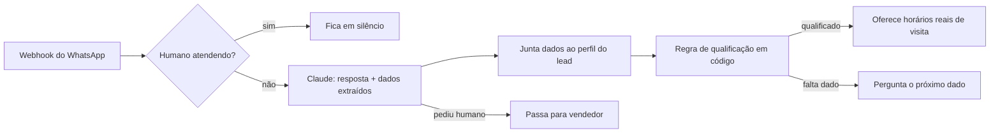

# Agente SDR com IA para WhatsApp

Agente de pré-vendas (SDR) que conversa com leads pelo WhatsApp e faz quatro coisas:

- qualifica o lead;
- agenda uma visita técnica;
- passa a conversa para um vendedor quando precisa;
- fica calado enquanto um humano está atendendo.

Usa o Claude (API da Anthropic) com saídas estruturadas. Também roda **sem chave de API**, com uma IA simulada por regras, para testar na hora.

> Projeto de portfólio. A empresa do exemplo, **Vértice Solar** (energia solar em Goiás), é fictícia. A arquitetura é a mesma que uso em agentes em produção para clientes reais.

## Como funciona



**Decisões de projeto**

- **A IA conversa, o código decide.** O modelo devolve um JSON validado por schema (Zod + structured outputs): a resposta, os dados que o cliente informou e a intenção. Quem calcula se o lead está qualificado é uma função pura em [`src/domain/lead.ts`](src/domain/lead.ts). A regra é previsível, testável e não muda com o humor do modelo.
- **A IA não inventa agenda.** Os horários vêm de [`src/scheduling/slots.ts`](src/scheduling/slots.ts). Se o modelo devolver um horário que não foi oferecido, o agendamento é recusado.
- **Pausa humana com prazo (TTL).** Quando um vendedor responde pelo mesmo número, o agente se cala. Se o vendedor esquecer de devolver a conversa, a pausa expira sozinha ([`src/handoff/human-pause.ts`](src/handoff/human-pause.ts)). Isso evita leads abandonados.
- **Falha segura.** Se o modelo recusar ou não devolver um JSON válido, o agente responde "Só um instante" e passa o lead para um humano. A requisição também usa o fallback de modelo do lado da API.
- **Prompt em cache.** O prompt fixo fica em cache e o estado do lead entra como mensagem de sistema no fim da conversa. Isso reduz custo e latência.

## Rodando

Requer Node.js 22 ou mais novo.

```bash
npm install
npm run chat      # conversa no terminal (IA simulada, sem chave)
npm test          # 16 testes
```

Com o Claude:

```bash
cp .env.example .env   # preencha ANTHROPIC_API_KEY e LLM=anthropic
npm run chat
```

Exemplo de conversa no terminal:

```text
você> Oi
lia> Pra começar, de qual cidade você fala?
você> Sou de Goiânia
lia> A instalação seria em casa, apartamento, comércio ou propriedade rural?
...
você> Queria instalar em 2 meses
lia> Perfeito, anotei tudo!
     Pelo que você me contou, energia solar faz sentido pra você! Posso agendar uma visita técnica
     gratuita: quarta 14/10 às 9h, quarta 14/10 às 14h, quinta 15/10 às 9h. Qual fica melhor?
   [lead: quente, 100 pts · status: em_conversa]
você> quarta às 14h
lia> Combinado, visita marcada para quarta 14/10 às 14h.
```

No terminal, `/vendedor <texto>` simula um humano respondendo, `/devolver` devolve a conversa ao agente e `/lead` mostra o perfil.

### API HTTP

```bash
npm run dev
```

| Rota | O que faz |
| --- | --- |
| `POST /webhook/whatsapp` | Recebe `{ from, text, fromMe }`. Com `fromMe: true`, é um vendedor respondendo e o agente pausa. |
| `GET /leads` | Lista os leads com perfil, status e visita agendada. |
| `POST /leads/:phone/release` | Devolve a conversa ao agente. |
| `GET /health` | Verificação de saúde. |

```bash
curl -X POST localhost:3000/webhook/whatsapp -H "content-type: application/json" \
  -d '{"from":"5562999990000","text":"Oi, sou de Anápolis"}'
```

Docker:

```bash
docker build -t whatsapp-sdr-agent .
docker run -p 3000:3000 --env-file .env whatsapp-sdr-agent
```

## Estrutura

```text
src/
  agent/        orquestração da conversa, prompt e schema da resposta
  domain/       perfil do lead e regra de qualificação
  llm/          Claude (Anthropic SDK) e IA simulada
  handoff/      pausa quando um humano assume
  scheduling/   horários de visita
  store/        armazenamento das conversas (memória; Redis/PostgreSQL em produção)
  app.ts        rotas HTTP (Fastify)
  cli.ts        simulador de WhatsApp no terminal
test/           testes com Vitest
```

## Stack

TypeScript · Node.js · Fastify · Zod · Anthropic SDK (Claude) · Vitest · Docker · GitHub Actions

## Licença

MIT
